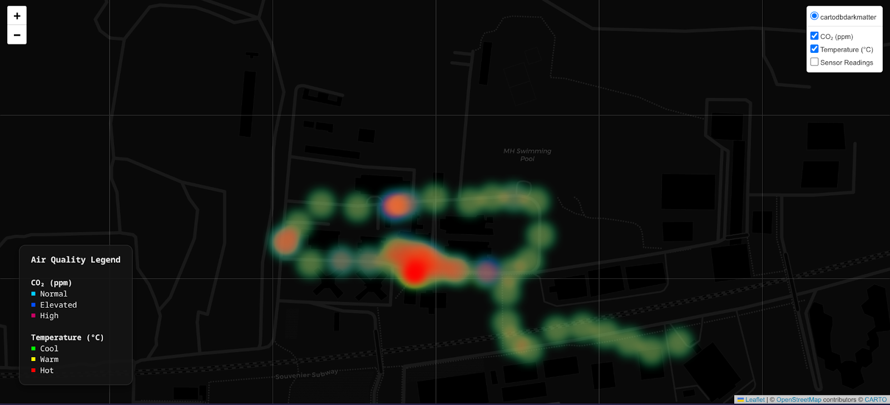

# Edge AQI

A three-tier edge system for indoor air quality monitoring. An ESP32 samples the air, a phone running Termux tags each reading with GPS, and a cloud backend stores the data and renders it as an interactive heatmap.

---

## Architecture

```
[ESP32-S3 sensor node]   DHT11 + MQ135 + OLED
        |
        | HTTP POST, one averaged reading per 5 samples
        v
[Fog node: Android phone / Termux]   Flask, GPS, outlier rejection
        |
        | HTTP POST with lat/lon attached
        v
[Cloud backend]   Flask + SQLite, stores the average of every 10 readings
        |
        v
[air_quality_map.html]   Folium heatmap
```

---

## Firmware (`firmware/`)

ESP32-S3 with PlatformIO and the Arduino framework.

- **DHT11** on GPIO 4 for temperature and humidity
- **MQ135** on GPIO 7 for CO2 (ppm), using a power-law curve against a calibrated R0 read from EEPROM. Falls back to `R0_DEFAULT` (67) if EEPROM is blank.
- **SH1106 128x64 OLED** over I2C shows the latest averages
- **NeoPixel** on GPIO 48 is red while connecting to WiFi and green once connected
- **Adaptive sampling:** every 2 s below 1000 ppm, 1 s below 1800 ppm, and 0.5 s above that or when CO2 rises more than 100 ppm between samples
- Every 5 samples, the averages are POSTed to the fog node at `http://<gateway_ip>:5000/sensor` with up to 3 attempts
- Reconnects automatically if WiFi drops

**Setup:**

1. Copy `firmware/src/secrets.h.example` to `firmware/src/secrets.h` and add your WiFi credentials.
2. Flash with `pio run --target upload`.
3. (Optional) Calibrate R0. `callib.cpp` is commented out by default. Comment out `main.cpp`, uncomment `callib.cpp`, flash it, and run it with the sensor in clean air. It saves R0 to EEPROM. Then switch back and reflash `main.cpp`.

---

## Fog Node (`fognode/`)

A Flask server that runs on an Android phone through Termux.

- Receives readings on `POST /sensor`
- Rejects outliers: once 10 readings are in the window, a reading is dropped if any field is more than 4 standard deviations from the mean of the last 20
- Gets GPS from `termux-location` (needs the Termux:API app and `pkg install termux-api`), cached between polls, with static fallback coordinates if GPS fails
- Forwards the reading with lat/lon and a UTC timestamp to the backend

**Setup:**

```bash
cp .env.example .env   # set CLOUD_BACKEND_URL
uv sync
uv run main.py         # port 5000
```

| Variable | Default | Description |
|---|---|---|
| `CLOUD_BACKEND_URL` | (required) | Full URL of the backend `/data` endpoint |
| `FALLBACK_LAT` | `11.3410` | Latitude used if GPS fails |
| `FALLBACK_LON` | `77.7172` | Longitude used if GPS fails |
| `GPS_REFRESH_INTERVAL` | `60` | Seconds between GPS polls |
| `COORDINATOR_INTERVAL_MS` | unset | Optional fixed sampling interval sent back to the ESP32. Leave unset to keep adaptive sampling. |

---

## Backend (`backend/`)

A Flask API that stores readings in SQLite and regenerates the heatmap.

- `POST /data` takes `temperature`, `humidity`, `co2_ppm`, `latitude`, `longitude`, and optionally `timestamp` and `source`
- Buffers readings in memory and stores the average of every 10 as one row
- Regenerates `air_quality_map.html` after each stored row
- `GET /readings?limit=N` (default 50, max 500), `GET /stats`, `GET /health`

| Variable | Default | Description |
|---|---|---|
| `DB_PATH` | `backend/air_quality.db` | SQLite database file |
| `PORT` | `5001` | Port for `main.py` |

**Setup:**

```bash
uv sync
uv run main.py   # port 5001
```

To run under gunicorn:

```bash
gunicorn -w 1 -b 0.0.0.0:5001 main:app
```

Keep it to one worker since the buffer lives in memory. The table is only created when running `main.py` directly, so start it that way once on a fresh database.

Readings from earlier runs are kept in `backend/Old readings/`.

---

## Heatmap

The backend writes `backend/air_quality_map.html` after each stored reading. Open it in any browser.

Layers:
- **CO2 heatmap** (cyan to pink), shown by default
- **Temperature heatmap** (green to red)
- **Sensor markers** with popups showing raw CO2, temperature, humidity, coordinates, and timestamp

Colors are min-max normalized across the dataset, so they show relative levels rather than fixed thresholds.



To regenerate the map manually:

```bash
cd backend
uv run map.py
```

---

## Project Structure

```
firmware/       ESP32-S3 PlatformIO project
fognode/        Phone-based fog node (Flask, Termux)
backend/        Cloud backend (Flask, SQLite, Folium)
assets/         Map preview image
```

---

## Dependencies

| Layer | Key libraries |
|---|---|
| Firmware | DHT sensor library, Adafruit NeoPixel, U8g2 |
| Fog node | Flask, requests, python-dotenv |
| Backend | Flask, folium, pandas, numpy, gunicorn |
